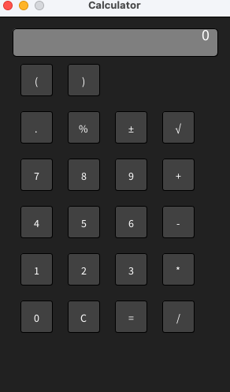

### OOP Calculator for Programming 1

[Download / View Calculator Folder](src/Calculator)

# The Calc

## Overview
This program is a fully functional GUI calculator built in Processing that allows users to perform basic arithmetic and advanced operations. Users can input numbers, run operations, and clear or reset values using either an interactive on-screen button interface or standard keyboard controls.

## Current Status
Working:

Interactive button grid displaying 22 functional buttons with dynamic hover effects

Complete mouse click support for entering digits, math operators, and clearing values

Keyboard support allowing direct numerical and operation typing via keyPressed()

Full calculation logic supporting addition, subtraction, multiplication, division, decimal points, percentages, positive/negative toggling, and square roots

Console debugging output tracking operands, active operations, and display state in real time

Still in progress:

Parentheses logic for complex order of operations

## How to Run
Built with Processing.
Processing version: 4.3

Open the project folder containing the sketch files, then open the main sketch tab Calculator.pde in Processing and press the Run (Play) button.

## Controls
Mouse:
Hover over any calculator button to highlight it, and click to press the button, update the screen display, and execute calculations.

Keyboard:

0–9: Input digits

+, -, *, /: Standard math operators

Enter or =: Calculate result

Backspace or C / c: Clear calculator state

.: Insert decimal point

%: Convert current display value to percentage

n or N: Toggle positive/negative sign (±)

s or S: Square root (√)

( and ): Parentheses (planned for full evaluation logic, currently active in input)

## Project Files
Calculator.pde: Main sketch handling setup, global state variables, drawing loops, display rendering, and input handlers (mousePressed, keyPressed).

Button.pde: Object class containing properties for position, size, value, hover states, and drawing logic.

## Testing
[Actions: Click button 7, click +, click button 8, then click =.

Expected Result: Display shows 7, switches to fresh input on 8, and updates to 15.0 upon pressing =. Console prints state l: 7.0 r: 8.0 result: 15.0.

Actual Result: Display correctly showed 15.0, and console output matched expected values.]

## Next Step
Implement nested calculation logic to handle parentheses ( and ) for multi-step arithmetic expressions.
